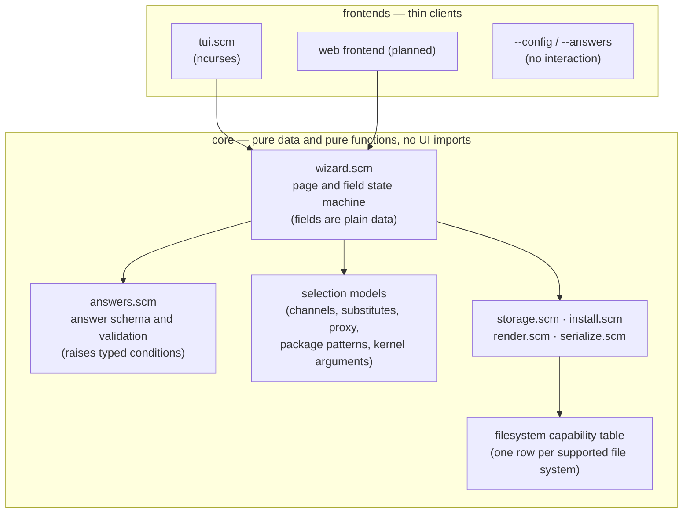

# Architecture

Gradus is one installer with many frontends. The core — the answer schema, the
wizard state machine, the storage operations and the install pipeline — knows
nothing about terminals, browsers or screens. A frontend renders the core's data
and feeds it input. The console TUI (`gradus/script.scm --tui`) is the first
frontend; a web frontend is planned and must reuse the same core without
changes to it.

Contract version: **1**. Product version: **0.3.0**.

## Layers



The rule that keeps the layers honest: **core modules must not import a
frontend, and a frontend must not reach past the wizard state machine into
storage or install code.** Anything a frontend needs from the core must be
expressible as part of the data contracts below.

## The data contracts of the core

### 1. The answer schema (`answers.scm`)

The single source of truth for what an installation decision is. Keys, types,
required fields and cross-field rules live here. Both frontends and the CLI
validate against it; the validator is the same code.

### 2. The wizard page model (`wizard.scm`)

A page is a list of fields; a field is plain data:

```
(label, kind, value, options)
```

`kind` is one of `menu`, `text`, `password`, `check`, `action`. Defaults,
option lists and per-field validation are data, not code paths in a frontend.
The TUI draws this structure with ncurses; a web frontend renders the same
structure as HTML. When a page needs a new widget, the field kind is added
here first, and every frontend implements it.

### 3. Selection models (`selection.scm`)

Everything the operator *selects* rather than *types* is a core data model,
never a frontend feature:

| model | shape | notes |
|:--|:--|:--|
| channels | ordered list of `(name, url, commit)` | order is authority order; the official channel is always available and never hidden |
| substitutes | ordered list of `(url, kind, key)` | order is preference order — the first reachable server wins; adding a server places it first |
| proxy | `(http, https, no_proxy)` | applied to the live daemon for the install and persisted to the target |
| package patterns | curated groups, see below | the fast path for a sensible base system |
| kernel arguments | preset + free list | offered as keep-default / none / edit |

**Package patterns** follow the idea the openSUSE installer calls *patterns*: a
named group of packages that yields a working set of functionality —
"remote access", "monitoring tools", "network utilities" — instead of asking
the operator to know package names. Each pattern is a core data row:

```
(pattern (name 'remote-access)
         (description "SSH and terminal multiplexing")
         (packages (list "openssh" "tmux" "rsync")))
```

The installed set is `%base-packages` + the chosen profile + the selected
patterns + explicitly named packages, expanded by `render.scm` into one
manifest. Patterns are curated in this repository and versioned with it;
resolving them dynamically against a channel is a possible later extension.
Per-user software after installation is the domain of `guix home` and out of
scope here.

All five models are consumed by `install.scm` uniformly: changing the
substitute list or the proxy restarts the live `guix-daemon` with the new
settings as a fixed step of the install pipeline, not a special case.

### 4. The filesystem capability table (`fs.scm`)

A supported file system is one row of data, not a set of branches scattered
across modules. The general handling is uniform: prepare creates the file
system with its label, identification reads the label and UUID back, the
mount step addresses the volume by that identification, `render.scm` and
`serialize.scm` declare it, and the boot row states what the bootloader
needs to know.

| question | answered by |
|:--|:--|
| which package provides the tools | `tool-package` |
| how to create it and set its label | `mkfs` tool and label flag |
| how to read back its label and UUID | `identify` command |
| how the mounted source is addressed | `mount-source`: label, UUID or device |
| how it is settled after the last write | `settle` command, or none |
| what the Guix declaration looks like | `declaration` |
| what the bootloader needs to know | `boot-notes` |

Adding a file system is adding a row and running the acceptance matrix in
`docs/testing.md`; no module gains a new special case.

**Settling the target.** The installation does not end when the last file is
written: the target is unmounted and then settled with the tool its own row
names. An ext file system left mounted comes down with its journal unapplied,
stale free counts in the superblock and `orphan_present` still set — flags
GRUB does not understand, so the machine falls into rescue mode claiming
`normal.mod` is missing while the file sits in place. Every row therefore
unmounts; ext2/3/4 additionally run `e2fsck -fy`, which applies the journal
and corrects the superblock. Rows settle with their own checker when they
need one: `btrfs check` is a recovery tool rather than a routine one, and
e2fsck cannot read btrfs or xfs at all. The settle step reads the table — a
checker that does not understand the file system is an error to report, not a
check that passes.

**Known exception — identification on btrfs.** libblkid could not read a
btrfs file system created by current btrfs-progs, whose default on-disk
format (block-group-tree) predates libblkid's parser. The btrfs row therefore
identifies with `btrfs filesystem show`, which reads the superblock natively.
Every other row identifies with `blkid -o export`. Prepare, mount and
declaration code consume the row's `identify` command and never invoke blkid
directly.

### 5. Typed conditions

The core raises structured conditions, never prints. A condition carries a
category and a message:

| category | meaning |
|:--|:--|
| `decision` | the operator's input is incomplete or contradictory |
| `environment` | the machine or the network refuses — a busy or missing disk, a missing tool, an unreachable server |
| `defect` | the installer itself failed |

Frontends render conditions in their own idiom — the TUI below the form that
caused them, a web frontend as structured JSON. Categories are not exit
codes: the mapping onto `docs/contract.md` §7 follows the contract, not the
category. `decision` exits 2; an `environment` refusal before anything is
written to the target exits 3, one encountered during installation exits 4;
a `defect` exits 4. The CLI entry point applies the mapping, so every
frontend inherits it.

## Implementation status

Implemented today: the answer schema and validator, the wizard page model
with its back semantics, typed conditions, the selection models for
substitutes, proxy and kernel arguments, the filesystem capability table
with its settling dispatch, the storage operations for the supported file
systems, and the TUI. Not yet consumed: channels, specified above; and the
package-pattern table, which lands with its own refactor. The web frontend is
planned. Until a section is implemented, `docs/contract.md`
section 2 and `docs/pages.md` remain the authority on what the software
accepts today.

## Cross-cutting invariants

**Secrets.** Passphrases and passwords never appear in a command line, a log
line or the provenance record. The only transport is `with-secret-file`: a
0600 file on `/dev/shm`, passed to the tool by path and removed when the
operation ends.

**Logs.** The core writes `/var/log/gradus-install.log` with stage markers
(`[1/4]` … `[4/4]`). Frontends display log output; they never write it.

**Language.** User-visible strings are tables in the core. The console TUI
serves English only — the Linux console cannot render CJK with its fixed
512-glyph font — and the web frontend serves the same tables including
Chinese. Translating is filling one table, not touching two codebases.

## Frontend requirements

A Gradus frontend is a thin client that:

1. renders the wizard page model (fields, options, defaults) and the
   selection models (lists, orderings, checkboxes);
2. captures input and applies the back semantics uniformly — inside an edited
   field, back cancels the edit; on a page, back moves one page earlier; the
   state machine decides how far back "back" goes;
3. renders typed conditions verbatim, including the category;
4. never formats or second-guesses core data. If the frontend needs a string
   the core does not provide, the core grows it.

## Packaging

The product is developed as a source checkout and ships as a Guix package:
`guix.scm` defines it, so the installer can be built with `guix build -f
guix.scm`, referenced by other Guix packages, and — as a channel — consumed
directly by image build pipelines that want to embed the installer in a
medium. A live medium is one such artefact: a downstream image recipe that
boots into the wizard with the required tools present. The core carries no
knowledge of any medium.

## Testing layers

| layer | what it proves | where |
|:--|:--|:--|
| unit | validators, layout arithmetic, serialization, page model transitions | `make check` |
| walkthrough | a frontend accepts a scripted input sequence across all pages | scripted pty / driver |
| install matrix | one VM install per file-system row × firmware | `docs/testing.md` T2/T9/T10 |

A change that passes the unit layer but not the install matrix is not done;
the filesystem findings that produced the capability table were all
matrix-layer discoveries.
